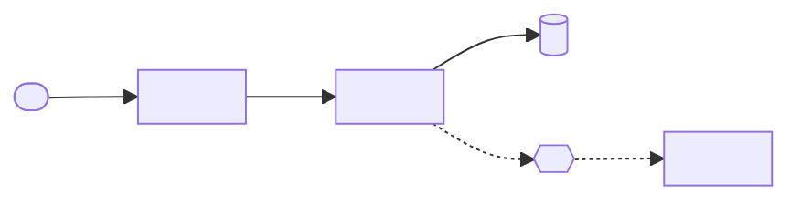

# SPECIFICATION — <project name>

<!-- The technical make-up of the system and why it is built this way.
Not HOW to write code (that is PATTERN and POLICY), but WHAT the system is made of.
Endpoint and event contracts → API.md. -->

## Service diagram

<!-- Solid arrow — synchronous call, dashed — asynchronous event. -->

---

## Services

<!-- One card per service and per external system (DB, broker, cache, S3, third-party APIs). -->

### `<svc-orders>`

- **Purpose:** <which part of the business it owns>
- **Why a separate service:** <own load, own team, own DB...>
- **Owns data:** `<orders_db>` → `DATABASE.md#<orders_db>`
- **Depends on:** `<svc-billing>`, `<broker>`

### `<Redis>`

- **Purpose:** <session cache / rate limit / ...>
- **Why this one:** <...>
- **Considered and rejected:** <Memcached — no data structures>

---

## Links and protocols

| From | To | Protocol | Sync? | Why |
|---|---|---|---|---|
| `<svc-orders>` | `<svc-billing>` | <HTTP/REST> | yes | <need the answer now to show the invoice> |
| `<svc-billing>` | `<svc-notify>` | <RabbitMQ> | no | <a notification may be late; billing must not wait> |

---

## Load and data

<!-- The numbers the architecture is built for. From the user's answers; missing → ❓. -->

- **Users / RPS:** <normal / peak>
- **Data volume:** <now / growth per month>
- **Expected extensions:** <what may be added later and how the architecture allows it>

---

## Tech stack

| Layer | Technology | Version | Why |
|---|---|---|---|
| <Backend language> | <Python> | <3.12> | <...> |
| <Framework> | <FastAPI> | <...> | <...> |
| <DB> | <PostgreSQL> | <16> | <...> |
| <Env / build> | <Nix flakes> | — | <reproducibility> |

---

## Auth

### External auth

<!-- User or external client → system. -->

- **Method:** <JWT / sessions / OAuth2 / API keys for partners>
- **Issued at:** <`POST /v1/auth/login` → `API.md#<...>`>
- **Lifetime:** <access 15 min, refresh 30 days>
- **Client-side storage:** <httpOnly cookie / ...>
- **Roles and permissions:**

  | Role | Can do |
  |---|---|
  | <client> | <...> |
  | <manager> | <...> |

### Internal auth

<!-- Service → service. -->

- **Method:** <mTLS / service tokens / private network without auth (then explain why that is OK)>
- **Who issues and checks:** <...>
- **Rotation:** <...>

---

## Working with data

<!-- How the system as a whole handles data. Rules like "delete via DELETE" → POLICY.md,
recurring techniques like "a repository per table" → PATTERN.md. -->

- **DB access:** <only through the repository layer / ORM <...> / raw SQL forbidden>
- **Transactions:** <where they start and end>
- **Cache:** <what is cached, TTL, how it is invalidated>
- **Other services' data:** <a service never reads another service's DB, only its API>
- **Rules:** → `POLICY.md#data`

---

## Secrets

- **Stored in:** <sops-nix / Vault / CI environment variables>
- **How they reach the service:** <...>
- **Rotation:** <how and how often>
- **Variable list (no values):** `<.env.example>`
- **Handling rules:** → `POLICY.md#security`

---

## Limits

| What | Limit | Set in | What happens when exceeded |
|---|---|---|---|
| <Upload file size> | <20 MB> | `<config/upload.py>` | <`413`> |
| <Request body size> | <1 MB> | `<nginx.conf>` | <`413`> |
| <Requests per minute per user> | <60> | `<middleware/ratelimit.py>` | <`429`> |

---

## Environments

| Environment | Purpose | Differences | How it is deployed |
|---|---|---|---|
| `<dev>` | <local development> | <external APIs mocked> | `<nix develop>` |
| `<stage>` | <pre-release check> | <copy of prod without real payments> | <CI on merge to `main`> |
| `<prod>` | <production> | — | <CI on tag> |
